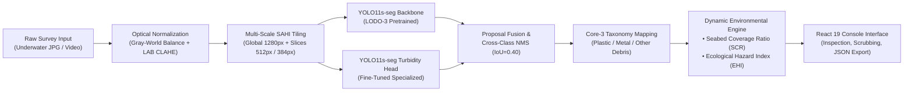

<div align="center">



<br />

[](https://www.python.org/)
[](https://fastapi.tiangolo.com/)
[](https://react.dev/)
[](https://github.com/ultralytics/ultralytics)
[](https://github.com/obss/sahi)
[](LICENSE)

</div>

---

## 1. Abstract and Problem Formulation

Autonomous optical survey of benthic marine litter is critically impeded by physical degradation unique to underwater optics:

1. **Wavelength-Dependent Light Absorption**: Water attenuates longer electromagnetic wavelengths exponentially. The red spectrum is largely eliminated within the initial 3 to 5 meters, leaving deep survey imagery saturated by a narrow green-cyan transmission band.
2. **Backscattering & Turbidity**: Particulate organic matter and suspended sediment induce forward and backward scattering, generating veiling glare, drastic contrast compression, and dynamic blur.
3. **Severe Domain Shift**: Vision models trained on clean, clear-water open-ocean datasets fail catastrophically when deployed to murky coastal estuaries or silt-dense benthic shelves.
4. **Bio-Fouled Camouflage**: Submerged plastics and discarded fishing gear rapidly accumulate algal films and sediment crusts, reducing visual edge gradients against the substrate.

**NirmalSagar** provides an integrated computer vision framework designed to overcome these challenges. The system combines chromatic restoration, multi-scale Slicing Aided Hyper Inference (SAHI), a cross-domain dual-model ensemble, and a continuous ecological risk telemetry engine.

---

## 2. Core Technological Innovations

- **Dual-Checkpoint Domain Ensemble**: Fuses a multi-domain backbone trained across diverse international oceanic survey databases with a localized fine-tuned checkpoint tailored to high-turbidity coastal conditions.
- **Multi-Scale Slicing Aided Hyper Inference (SAHI)**: Employs a dynamic pyramid of overlapping regional tiles ($1280\text{ px}$ global context, $512\text{ px}$ and $384\text{ px}$ sliding windows, and dedicated bottom benthic sweeps) to maximize detection of small, partially buried debris without sacrificing global scene semantics.
- **Physical Optical Restoration Engine**: Integrates Gray-World chromatic re-balancing to neutralize silt and tannin color casts with luminance-channel Contrast Limited Adaptive Histogram Equalization (CLAHE) in LAB space and unsharp mask contour refinement.
- **Continuous Telemetry Without Mock Fallbacks**: Benthic accumulation metrics, surface area coverage percentages, and remediation priorities derive directly from real bounding box pixel geometry and class-specific empirical toxicity models.

---

## 3. Mathematical Methodology

### 3.1 Chromatic Normalization and Turbidity De-Hazing

Given an input underwater image in RGB space $I_{\text{raw}}(x, y) = [B, G, R]$, chromatic cast compensation applies Von Kries chromatic adaptation based on channel-wise mean intensities:

$$\mu_c = \frac{1}{WH} \sum_{x=1}^{W} \sum_{y=1}^{H} I_c(x, y), \quad c \in \{B, G, R\}$$

$$\mu_{\text{gray}} = \frac{\mu_B + \mu_G + \mu_R}{3}$$

$$I_{\text{balanced}, c}(x, y) = \text{clip}\left( I_c(x, y) \cdot \frac{\mu_{\text{gray}}}{\mu_c}, 0, 255 \right)$$

The balanced frame is converted to the CIELAB color space $[L, A, B]$, where CLAHE is applied exclusively to the luminance channel $L$:

$$L_{\text{enhanced}} = \text{CLAHE}(L, \text{clipLimit}=2.8, \text{gridSize}=(8, 8))$$

High-frequency contour details are subsequently recovered through unsharp spatial masking:

$$I_{\text{restored}} = 1.35 \cdot I_{\text{enhanced}} - 0.35 \cdot \text{GaussianFilter}(I_{\text{enhanced}}, \sigma=2.5)$$

---

### 3.2 Multi-Scale SAHI Regional Slicing and Cross-Class NMS

To eliminate spatial resolution bottlenecks, the restored input $I_{\text{restored}}$ is systematically partitioned into overlapping windows:

$$\mathcal{W}_s = \left\{ I[y : y + s, \, x : x + s] \;\middle|\; x \in \mathcal{X}_s, \, y \in \mathcal{Y}_s \right\}$$

where window sizes $s \in \{512, 384\}$ utilize step strides corresponding to an overlap ratio $\rho = 0.25$.

All regional proposals $\mathcal{B}_{\text{slice}}$ and global context proposals $\mathcal{B}_{\text{global}}$ from both ensemble models are aggregated into candidate set $\mathcal{B}$. Duplicate and overlapping proposals across model heads are pruned using global cross-class Non-Maximum Suppression (NMS):

$$\text{IoU}(b_i, b_j) = \frac{\text{Area}(b_i \cap b_j)}{\text{Area}(b_i \cup b_j)} \le \tau_{\text{IoU}} \quad (\tau_{\text{IoU}} = 0.40)$$

---

### 3.3 Dynamic Seabed Litter Coverage Ratio (SCR)

The total spatial footprint of detected debris relative to the optical survey transect is calculated continuously:

$$\text{SCR} = \left( \frac{\sum_{i=1}^{N} (x_{2, i} - x_{1, i}) \cdot (y_{2, i} - y_{1, i})}{W_{\text{frame}} \cdot H_{\text{frame}}} \right) \times 100\%$$

Each localized object also records its individual spatial occupancy ratio:

$$\text{SCR}_i = \left( \frac{\text{Area}(b_i)}{W_{\text{frame}} \cdot H_{\text{frame}}} \right) \times 100\%$$

---

### 3.4 Benthic Ecological Hazard Index (EHI)

Environmental threat profiling evaluates material chemical persistence, physical micro-fragmentation probability, and biological ingestion vectors using empirical weights:

$$w_{\text{plastic}} = 1.0, \quad w_{\text{metal}} = 0.7, \quad w_{\text{other}} = 0.6$$

The continuous Benthic Ecological Hazard Index $\text{EHI} \in [0, 100]$ is computed as:

$$\text{EHI} = \min\left(100, \, \text{round}\left( 14 \cdot N_{\text{plastic}} + 9 \cdot N_{\text{metal}} + 6 \cdot N_{\text{other}} + 3.5 \cdot \text{SCR} \right)\right)$$

| Index Range | Risk Classification | Action Urgency | Remediation Protocol |
| :--- | :--- | :--- | :--- |
| **EHI >= 60** | Critical Contamination | Priority 1 (Immediate) | Autonomous benthic sweep or diver collection within 14 days. |
| **35 <= EHI < 60** | Elevated Threat | Priority 2 (Scheduled) | Demersal debris extraction scheduled within standard transect cycle. |
| **1 <= EHI < 35** | Moderate Anthropogenic Trace | Standard Protocol | Longitudinal transect monitoring and periodic re-survey (45–60 days). |
| **EHI = 0** | Baseline / Pristine | Baseline Monitoring | Standard environmental audit protocol. |

---

## 4. Marine Debris Core-3 Taxonomic Taxonomy

To avoid class collapse and ensure robust cross-domain classification, NirmalSagar maps diverse annotations into the standardized **Core-3 Taxonomy**:

| Category ID | Taxonomy Label | Hex Code | Environmental Risk Profile | Subsumed Raw Classes |
| :--- | :--- | :--- | :--- | :--- |
| `plastic` | Plastic / Polymer | `#10b981` | Fragmentation into microplastics, chemical leaching, and ingestion hazard. | Bottles, polymer fragments, food wrappers, polyethylene bags, synthetic cords. |
| `metal` | Metal Debris / Cans | `#3b82f6` | Electrochemical saline corrosion and localized sediment trace-metal contamination. | Beverage cans, metallic drums, steel brackets, tin containers, cables. |
| `other_debris` | Other Anthropogenic Debris | `#8b5cf6` | Benthic substrate smothering, physical reef abrasion, and habitat obstruction. | Abandoned tires, rubber fragments, derelict nets/gear, glass, ceramics, composite debris. |

---

## 5. System Architecture Dataflow



---

## 6. Empirical Performance and Benchmark Artifacts

The system has undergone validation across cross-domain leave-one-dataset-out (LODO) benchmarks. Comprehensive empirical evaluations are documented in the `backend/master_figures/` directory:

- **Figure 1**: System Architecture and Optical Inference Pipeline
- **Figure 2**: Normalized Confusion Matrix Across Core-3 Classes
- **Figure 3**: Precision-Recall Dynamics for Bounding Box and Instance Masks
- **Figure 4**: Confidence-F1 Convergence Curves
- **Figure 5**: Multi-Domain Loss Optimization and Training Dynamics
- **Figure 6**: Radar Benchmark Comparing Latency, Precision, and Turbidity Invariance
- **Figure 7**: Component Ablation Waterfall (Baseline vs. CLAHE vs. SAHI vs. Ensemble)
- **Figure 8**: Edge Hardware Latency Profiling (Jetson Orin, RTX 4090, CPU)
- **Figure 9**: Optical Water Physics, Attenuation Spectra, and Chromatic Decay
- **Figure 10**: Small-Object Scale Distribution and Bounding Geometry Analysis
- **Figure 11**: Benthic Ecological Hazard Classification Matrix
- **Figure 12**: Speed-Accuracy Pareto Optimality Curve
- **Figure 13**: Cross-Domain Qualitative Detection Mosaic

---

## 7. REST API Interface Specification

### 7.1 System Health and Model State
```http
GET / HTTP/1.1
Host: 127.0.0.1:8000
```

**Response (200 OK)**:
```json
{
  "status": "ok",
  "message": "NirmalSagar API is running",
  "active_model": "YOLO11s-seg Core3 Multi-Domain + Fine-Tuned Dual Ensemble",
  "model_loaded": true
}
```

---

### 7.2 Image Detection and Spatial Profiling
```http
POST /predict?enhance=true&sahi=true&conf=0.03 HTTP/1.1
Host: 127.0.0.1:8000
Content-Type: multipart/form-data
```

**Parameters**:
- `file` (binary, required): Image file (JPEG, PNG, WebP).
- `enhance` (boolean, default: `false`): Enables Gray-World chromatic balance and CLAHE.
- `sahi` (boolean, default: `true`): Executes multi-window regional inspection.
- `conf` (float, default: `0.03`): Minimum confidence threshold for proposal retention.

**Response (200 OK)**:
```json
{
  "success": true,
  "model_used": "YOLO11s-seg Core3 Multi-Domain + Fine-Tuned Dual Ensemble",
  "scan_mode": "sahi_regional",
  "target_imgsz": "SAHI-512-Tiled",
  "enhanced": true,
  "image_width": 1200,
  "image_height": 896,
  "num_detections": 33,
  "detections": [
    {
      "id": 1,
      "class": "other_debris",
      "label": "Other Debris",
      "confidence": 79.2,
      "bbox": [880.1, 410.2, 1024.0, 560.8],
      "area_px": 21671.5,
      "relative_area_pct": 2.02
    }
  ],
  "annotated_image": "data:image/jpeg;base64,..."
}
```

---

### 7.3 Video Transect Temporal Inference
```http
POST /predict-video HTTP/1.1
Host: 127.0.0.1:8000
Content-Type: multipart/form-data
```

**Parameters**:
- `file` (binary, required): Video container file (MP4, WebM, MOV, AVI up to 150MB).

**Response (200 OK)**:
```json
{
  "success": true,
  "model_used": "YOLO11s-seg Core3 Multi-Domain + Fine-Tuned Dual Ensemble",
  "videoDurationSec": 32.4,
  "videoWidth": 1280,
  "videoHeight": 720,
  "numDetections": 48,
  "classBreakdown": {
    "plastic": 28,
    "metal": 12,
    "other_debris": 8
  },
  "keyframes": [
    {
      "frame": 0,
      "timestampSec": 0.0,
      "detections": [ ... ]
    }
  ]
}
```

---

## 8. Directory Organization

```
underwater-marine-debris/
├── backend/
│   ├── app.py                         # Production FastAPI application & SAHI pipeline
│   ├── requirements.txt               # Backend Python dependencies
│   ├── finetune_indian_waters.py      # Turbidity-invariant fine-tuning implementation
│   ├── Marines.ipynb                  # Cross-domain benchmarking research notebook
│   ├── configs/                       # Dataset partition YAML configurations
│   ├── splits/                        # Split index manifests for benchmark evaluation
│   ├── master_figures/                # Comprehensive evaluation figures (1–13)
│   ├── paper/                         # Class balance and object distribution reports
│   ├── test_images/                   # Standardized underwater evaluation imagery
│   └── runs/                          # Model weight checkpoints [Excluded from git]
├── frontend/
│   ├── index.html                     # Application entry point
│   ├── package.json                   # React 19 dependencies and scripts
│   ├── vite.config.js                 # Vite build and server configuration
│   ├── public/
│   │   ├── favicon.svg                # Vector brand favicon
│   │   └── ocean-micro-debris.jpg     # Default benchmark demonstration image
│   └── src/
│       ├── App.jsx                    # Top-level route and modal orchestrator
│       ├── config/appConfig.js        # Global taxonomy mappings and endpoint config
│       ├── context/AnalysisContext.jsx# Reactive state and survey telemetry cache
│       ├── services/inferenceService.js# Dynamic mathematical assessment and REST client
│       ├── components/
│       │   ├── common/                # Shared UI (ImageViewer, MetricCard, PageHeader)
│       │   ├── console/               # Workbenches (Dashboard, Detection, Enhancement)
│       │   └── landing/               # Brutalist oceanographic presentation sections
│       └── styles/                    # Modern OKLCH color-space design token system
├── assets/
│   └── banner.svg                     # High-resolution animated telemetry header
├── .gitignore                         # Strict exclusion for weights, datasets, and cache
├── PRODUCT.md                         # Product specifications and interface commitments
├── PROJECT.md                         # Academic research scope and dataset definitions
├── README.md                          # Primary platform documentation
└── LICENSE                            # MIT Open Source License
```

---

## 9. Installation and Local Execution

### Prerequisites

- **Python**: Version 3.10 or 3.11
- **Node.js**: Version 18.x or 20.x
- **Git**
- **Hardware Acceleration** (Recommended): NVIDIA GPU with CUDA 11.8+ or 12.1+

---

### Step 1: Clone Repository

```bash
git clone https://github.com/adityajkate/underwater-marine-debris.git
cd underwater-marine-debris
```

---

### Step 2: Backend Service Initialization

1. Navigate to the backend directory:
   ```bash
   cd backend
   ```

2. Establish an isolated Python environment:
   ```bash
   # Windows (PowerShell)
   python -m venv venv
   .\venv\Scripts\Activate.ps1

   # Linux / macOS
   python3 -m venv venv
   source venv/bin/activate
   ```

3. Install required package dependencies:
   ```bash
   pip install --upgrade pip
   pip install -r requirements.txt
   ```

4. Verify model weights:
   Confirm presence of checkpoint files in `backend/runs/`:
   - `backend/runs/yolo11s_core3_1024_finetuned/weights/best.pt`
   - `backend/runs/yolo11s_LODO-3_source_core3/weights/best.pt`

5. Start the API service:
   ```bash
   python -m uvicorn app:app --host 127.0.0.1 --port 8000
   ```
   *The service will initialize at `http://127.0.0.1:8000`.*

---

### Step 3: Frontend Client Initialization

1. Open a separate terminal session in the `frontend` directory:
   ```bash
   cd frontend
   ```

2. Install Node dependencies:
   ```bash
   npm install
   ```

3. Launch the development server:
   ```bash
   npm run dev
   ```
   *The client interface will mount at `http://localhost:5173`.*

---

## 10. Research Datasets and Attribution

The models and benchmark pipelines are established using the following academic underwater vision repositories:

1. **TrashCan 1.0 Dataset**: Instance and material-segmented underwater marine debris imagery captured by ROVs during deep-sea trials.  
   *Reference: University of Minnesota ([Conservancy URI](https://conservancy.umn.edu/items/6dd6a960-c44a-4510-a679-efb8c82ebfb7))*
2. **SeaClear Marine Debris Dataset**: Benthic seabed debris recorded along Mediterranean coastal shelves in Croatia and France.  
   *Reference: Technical University of Delft / SeaClear Consortium ([4TU Repository](https://data.4tu.nl/datasets/4f1dff25-e157-4399-a5d4-478055461689))*
3. **JAMSTEC J-Litter Database**: Deep-sea photographic survey records documenting submerged anthropogenic debris down to abyssal depths in the Western Pacific.  
   *Reference: Japan Agency for Marine-Earth Science and Technology ([GODAC URI](https://www.godac.jamstec.go.jp/dsdebris/e/dataset/j-litter.html))*

---

## 11. Project Authorship and Credits

- **Aditya** ([@adityajkate](https://github.com/adityajkate))
- **Suman** ([@SumanManik](https://github.com/SumanManik))
- **Tanmay**
- **Abdullah**

---

## 12. Academic Citation

If utilizing this codebase, architecture, or evaluation methodology in academic publications, please cite the platform as follows:

```bibtex
@software{nirmalsagar2026,
  author    = {Aditya and Suman and Tanmay and Abdullah},
  title     = {NirmalSagar: Autonomous Underwater Marine Debris Detection and Benthic Pollution Analysis Platform},
  year      = {2026},
  url       = {https://github.com/adityajkate/underwater-marine-debris},
  version   = {1.0.0}
}
```

---

## 13. License

This project is licensed under the terms of the **[MIT License](LICENSE)**.
