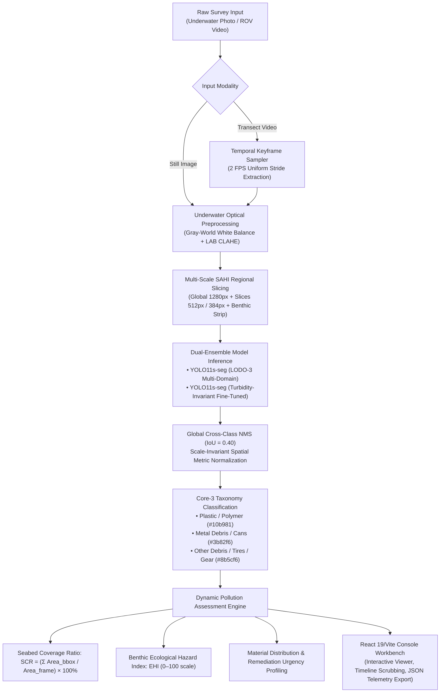

<div align="center">

# 🌊 NirmalSagar: Autonomous Underwater Marine Debris Detection & Benthic Pollution Analysis

**AI-Powered Optical Localization, Turbidity-Invariant Enhancement, and Ecological Risk Telemetry for Submerged Marine Litter**

[](https://www.python.org/)
[](https://fastapi.tiangolo.com/)
[](https://react.dev/)
[](https://github.com/ultralytics/ultralytics)
[](LICENSE)

</div>

---

## 📌 Executive Overview

**NirmalSagar** (*"Pure Ocean"*) is a specialized computer vision and oceanographic intelligence platform engineered to detect, classify, and segment submerged anthropogenic marine litter in turbid coastal waters and benthic seafloors.

Underwater computer vision faces severe optical degradation: chromatic absorption (red channel attenuation within 5 meters), backscattering from suspended organic sediment, murky tannins, and bio-fouled debris indistinguishable from natural seabed substrate. NirmalSagar addresses this **domain shift** through a hybrid dual-ensemble deep learning pipeline:
1. **LODO-3 Cross-Domain Pretrained Backbone**: Cross-trained across **TrashCan 1.0**, **SeaClear**, and **JAMSTEC J-Litter** datasets.
2. **Turbidity-Invariant Fine-Tuned Model**: Tuned specifically for murky, particulate-dense coastal waters.
3. **Multi-Scale SAHI Regional Slicing**: Slicing Aided Hyper Inference to resolve tiny fragments ($<32\times32\text{ px}$) without losing global context.
4. **Dynamic Ecological Risk Profiling**: Continuous mathematical scoring for Seabed Litter Coverage Ratio (SCR) and Benthic Ecological Hazard Index (EHI, 0–100).

---

## 🏛️ System Architecture



---

## 🏷️ Marine Debris Core-3 Taxonomy

To ensure robust cross-domain generalization without class imbalance collapses, NirmalSagar maps diverse raw labels into a standardized **Core-3 Marine Debris Taxonomy**:

| Class | Tag Color | Benthic Risk Description | Typical Marine Objects |
| :--- | :--- | :--- | :--- |
| **`plastic`** | `#10b981` (Emerald) | High Fragmentation Risk | Polymer bottles, degraded food packaging, plastic bags, synthetic films. |
| **`metal`** | `#3b82f6` (Ocean Blue) | Heavy Metal Leaching | Submerged beverage cans, metallic drums, steel brackets, tin containers. |
| **`other_debris`** | `#8b5cf6` (Violet) | Substrate Smothering | Abandoned tires, rubber fragments, derelict fishing nets/gear, composite wreckage. |

---

## 🚀 Key Capabilities

- **Multi-Window Regional Inspection (SAHI)**: Prevents false negatives on distant or small debris items by sweeping the image with overlapping $512\text{ px}$ and $384\text{ px}$ tiles alongside full-frame passes.
- **Dedicated Underwater Optical Enhancement**:
  - **Gray-World / Von Kries White Balancing**: Compensates for strong green/yellow turbidity and restores absorbed red spectrums.
  - **Luminance CLAHE in LAB Space**: Boosts contrast without blowing out organic ambient illumination.
  - **Unsharp Masking**: Sharpens bio-fouled contours against sandy and rocky sediments.
- **Video Transect Temporal Tracking**: Upload transect surveys (MP4, WebM, MOV) with keyframe sampling at 2 FPS, bounding box overlays, and timecode scrubbing.
- **Zero Mock Data — 100% Dynamic Telemetry**:
  - **Real Seabed Coverage Ratio (SCR %)** derived from genuine bounding box pixel dimensions and frame resolutions.
  - **Continuous Ecological Threat Index (EHI, 0–100)** calculated using material toxicity weights ($w_{\text{plastic}} = 1.0$, $w_{\text{metal}} = 0.7$, $w_{\text{other}} = 0.6$).
  - **Dynamic Action Plans**: Prioritizes cleanup urgency (Priority 1 immediate sweeps vs. Priority 2 scheduled demersal extractions).
- **Interactive Workbench UI**: Built with React 19, Vite, and Lucide Icons, featuring pan/zoom, split comparison mode, confidence filtering, and structured JSON telemetry export.

---

## 📁 Repository Structure

```
underwater-marine-debris/
├── backend/
│   ├── app.py                         # Production FastAPI server with SAHI & inference endpoints
│   ├── requirements.txt               # Backend Python dependencies
│   ├── finetune_indian_waters.py      # Turbidity-invariant fine-tuning script
│   ├── Marines.ipynb                  # Academic research & experimental training notebook
│   ├── configs/                       # YOLO dataset YAML configs (LODO-1, LODO-2, LODO-3, TrashCan)
│   ├── splits/                        # Evaluation dataset split indices (Jamstec, SeaClear, TrashCan)
│   ├── master_figures/                # Research report evaluation charts (Figures 1–13)
│   ├── paper/                         # Class balance, object scale, and deduplication reports
│   ├── test_images/                   # Sample underwater survey evaluation images
│   └── runs/                          # Local model checkpoints (yolo11s_LODO-3, yolo11s_finetuned) [Git-Ignored]
├── frontend/
│   ├── index.html                     # Frontend entrypoint
│   ├── package.json                   # React 19 dependencies & scripts
│   ├── vite.config.js                 # Vite development & build configuration
│   ├── public/
│   │   ├── favicon.svg                # Application branding icon
│   │   └── ocean-micro-debris.jpg     # Default sample survey plate
│   └── src/
│       ├── App.jsx                    # Root view orchestrator
│       ├── config/appConfig.js        # Centralized app configuration & taxonomy definitions
│       ├── context/AnalysisContext.jsx# Persistent survey history & backend telemetry context
│       ├── services/inferenceService.js# Dynamic mathematical pollution assessment & API transport
│       ├── components/
│       │   ├── common/                # Reusable UI (ImageViewer, MetricCard, PageHeader, StatusBadge)
│       │   ├── console/               # Workbenches (Dashboard, Image Detection, Video, Enhancement, Analytics)
│       │   └── landing/               # Brutalist oceanographic landing sections
│       └── styles/                    # OKLCH-grounded oceanographic stylesheet system
├── .gitignore                         # Excludes large checkpoints, raw datasets, node_modules, and zips
├── PRODUCT.md                         # Product specifications & design system commitments
├── PROJECT.md                         # Academic project definition & technical background
├── README.md                          # Comprehensive documentation (this file)
└── LICENSE                            # MIT Open Source License
```

---

## 🛠️ Installation & Setup

### Prerequisites

- **Python 3.10+** (tested on 3.10 and 3.11)
- **Node.js 18+** & **npm**
- **Git**

---

### Step 1: Clone the Repository

```bash
git clone https://github.com/adityajkate/underwater-marine-debris.git
cd underwater-marine-debris
```

---

### Step 2: Backend Setup (FastAPI & YOLO)

1. Open a terminal in the `backend/` directory:
   ```bash
   cd backend
   ```

2. Create and activate a Python virtual environment:
   ```bash
   # On Windows
   python -m venv venv
   .\venv\Scripts\activate

   # On Linux / macOS
   python3 -m venv venv
   source venv/bin/activate
   ```

3. Install required dependencies:
   ```bash
   pip install -r requirements.txt
   ```

4. Verify model weights:
   Ensure your trained weights (`best.pt`) are located in:
   - `backend/runs/yolo11s_core3_1024_finetuned/weights/best.pt`
   - `backend/runs/yolo11s_LODO-3_source_core3/weights/best.pt`

5. Start the FastAPI backend server:
   ```bash
   python -m uvicorn app:app --host 127.0.0.1 --port 8000
   ```
   *The API will be available at: `http://127.0.0.1:8000` (Interactive Swagger Docs at `http://127.0.0.1:8000/docs`).*

---

### Step 3: Frontend Setup (React & Vite)

1. Open a new terminal in the `frontend/` directory:
   ```bash
   cd frontend
   ```

2. Install dependencies:
   ```bash
   npm install
   ```

3. Launch the Vite development server:
   ```bash
   npm run dev
   ```
   *The web application will open at: `http://localhost:5173`.*

---

## 📡 API Reference

### 1. Health & Model Status
`GET http://127.0.0.1:8000/`

```json
{
  "status": "ok",
  "message": "NirmalSagar API is running",
  "active_model": "YOLO11s-seg Core3 Multi-Domain + Fine-Tuned Dual Ensemble",
  "model_loaded": true
}
```

### 2. Image Inference (SAHI Multi-Window Slicing)
`POST http://127.0.0.1:8000/predict?enhance=true&sahi=true&conf=0.03`

- **Parameters**:
  - `file`: Multipart image file (JPG, PNG, WebP)
  - `enhance` (bool): Apply turbidity and chromatic white balance restoration
  - `sahi` (bool): Enable Multi-Scale Slicing Aided Hyper Inference
  - `conf` (float): Minimum confidence threshold (0.01 – 1.0)

- **Response**:
```json
{
  "success": true,
  "model_used": "YOLO11s-seg Core3 Multi-Domain + Fine-Tuned Dual Ensemble",
  "scan_mode": "sahi_regional",
  "image_width": 1200,
  "image_height": 896,
  "num_detections": 33,
  "detections": [
    {
      "id": 1,
      "class": "other_debris",
      "label": "Other Debris",
      "confidence": 79.2,
      "bbox": [880.1, 410.2, 1024.0, 560.8],
      "area_px": 21671.5,
      "relative_area_pct": 2.02
    }
  ],
  "annotated_image": "data:image/jpeg;base64,..."
}
```

### 3. Video Transect Inference
`POST http://127.0.0.1:8000/predict-video`

- **Parameters**:
  - `file`: Underwater video file (MP4, WebM, MOV, AVI up to 150MB)

- **Response**:
```json
{
  "success": true,
  "model_used": "YOLO11s-seg Core3 Multi-Domain + Fine-Tuned Dual Ensemble",
  "videoDurationSec": 32.4,
  "videoWidth": 1280,
  "videoHeight": 720,
  "numDetections": 48,
  "classBreakdown": {
    "plastic": 28,
    "metal": 12,
    "other_debris": 8
  },
  "keyframes": [
    {
      "frame": 0,
      "timestampSec": 0.0,
      "detections": [...]
    }
  ]
}
```

---

## 📊 Scientific Datasets Used

1. **TrashCan 1.0 Dataset**: Instance and material-segmented underwater marine debris imagery captured by ROVs across sea trials in diverse oceanic regions. ([Access Dataset](https://conservancy.umn.edu/items/6dd6a960-c44a-4510-a679-efb8c82ebfb7))
2. **SeaClear Marine Debris Dataset**: Benthic seabed debris annotated across coastal test sites in Croatia and France (Marseille, Slano, Bistrina, Lokrum). ([Access Dataset](https://data.4tu.nl/datasets/4f1dff25-e157-4399-a5d4-478055461689))
3. **JAMSTEC J-Litter Database**: Deep-sea photographic survey records documenting submerged anthropogenic litter down to abyssal depths in the Western Pacific. ([Access Dataset](https://www.godac.jamstec.go.jp/dsdebris/e/dataset/j-litter.html))

---

## 👥 Contributors

- **Aditya** ([@adityajkate](https://github.com/adityajkate))
- **Suman** ([@SumanManik](https://github.com/SumanManik))
- **Tanmay**
- **Abdullah**

---

## 📄 License

This project is open-source and distributed under the terms of the **[MIT License](LICENSE)**.
